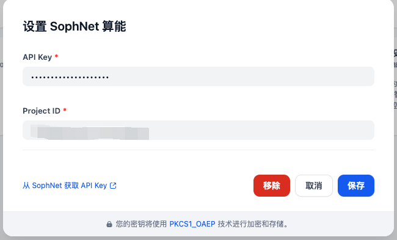
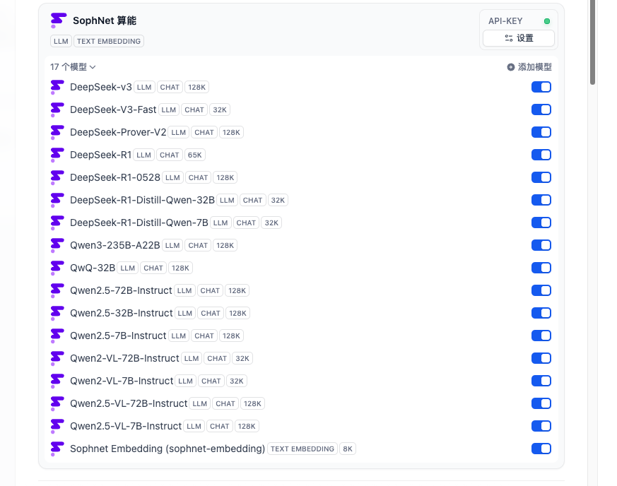

# SophNet

SophNet model provider plugin for Dify. It exposes the models enabled in your SophNet project through Dify's model management interface.

## Configure

Install the plugin, then add your SophNet API Key and Project ID in **Settings > Model Provider > SophNet**. You can create an API key from the [SophNet project console](https://www.sophnet.com/#/project/key).

## Supported capabilities

- Large language models: DeepSeek V4, GLM, Kimi, MiniMax, Qwen and retained legacy models
- Tool calling, structured output, image, video and audio input where the selected model supports them
- Text embeddings: `text-embeddings`, `clip-embeddings` and `bge-m3`
- Speech to text through a SophNet EasyLLM service
- Text to speech through a SophNet EasyLLM service, including streaming output
- Predefined models and customizable EasyLLM deployments

Existing model identifiers remain available so applications created with earlier plugin versions continue to resolve their configured models.

## Links

- [SophNet website](https://www.sophnet.com/)
- [SophNet model catalog](https://www.sophnet.com/#/model/list)
- [Source code and issue tracker](https://github.com/axdlee/sophnet)
- [Plugin development guide](./GUIDE.md)
- [Privacy policy](./PRIVACY.md)

## License

This project is licensed under the [MIT License](./LICENSE).

## Contact

For questions, compatibility reports, or feature requests, open an issue in the [source repository](https://github.com/axdlee/sophnet/issues).
